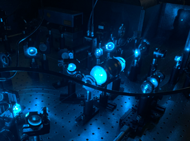
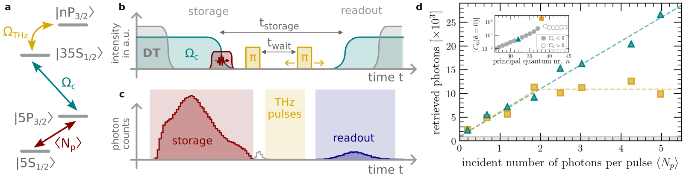
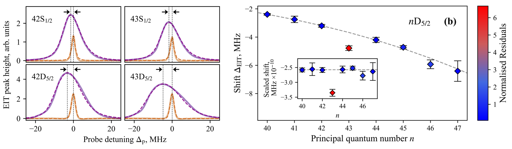
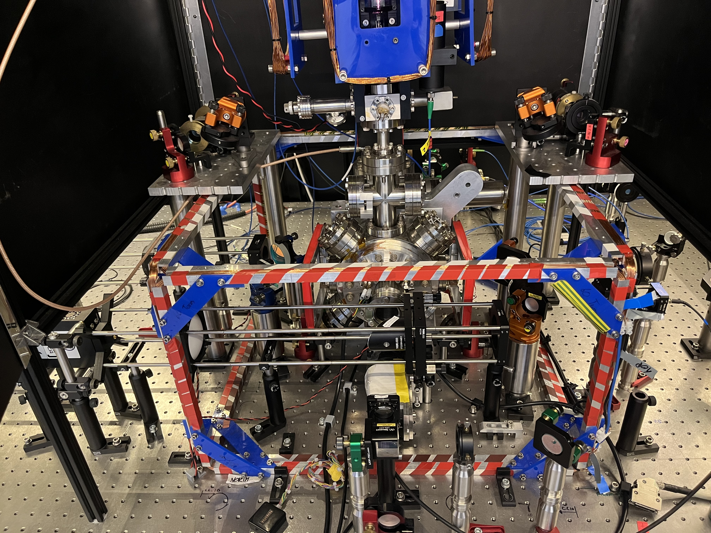

Our group is all about atoms, photons, and their properties. We are particularly curious about the interaction between photons and atoms, how to tailor the interactions to various applications and harness their special properties. As experimentalists, we conduct experiments in our labs at Durham University but our group also has a strong background in computational and theoretical quantum & atomic physics. As a team, we are a small group of kind and curious researchers immersed in the wider Quantum Light and Matter section at Durham Uni, and we are always welcoming new PhD students, postdocs or academic visitors. Please see our open positions at the bottom of the page and get in touch with Stuart Adams for any queries (c.s.adams@durham.ac.uk).

 

## What We Do...
### ...and what we are curious about.
As experimentalists we conduct research on different platforms, recent research has included both hot vapour and ultracold atom experiments. However, all our work has two main ingredients in common: Rydberg atoms and photons. 

Rydberg atoms are highly excited atomic states with exaggerated and peculiar properties, such as strong interactions, sensitivity to electromagnetic fields, and a wide range of atomic transitions in the radiofrequency and THz spectrum. All of these are relevant to our experiments in one way or another.

The other key ingredient for our experiments are photons. We use them to either manipulate the atomic properties by adding nonlinearities to the atomic dynamics via Rydberg interactions, to induce state changes, or to imprint interactions on the photons by dressing them with matter. In the past, we have used single photons as well as high-power photonic fields, spanning the rf, THz and optical range.

### Manipulating the properties of photons...
Our past research includes the creation of contactless interactions between pairs of photons Nature Physics 13, 655-658 (2017), which is difficult to achieve since photons do not interact with one another. We have therefore admixed the photons with matter in a quasiparticle called a polariton, which inherits properties of photons and matter to a variable degree. When admixing Rydberg atomic states to the photons one also inherits the strong nonlinear interactions between Rydberg states, which then creates an effective interaction between photons! 

||
|:--:|
|Level scheme and experimental sequence. Interaction-induced saturation of photon retrieval from strongly-interactiong 38P state (yellow squares). Taken from [arXiv: 2605.18664 (2026)](https://arxiv.org/pdf/2605.18664).|

These interacting photons can be used in future applications such as quantum information processing or sensing. For instance, Rydberg polaritons can be used as the fundamental building block of a quantum computer, a so-called qubit [PRL **127**, 063604 (2021)](https://journals.aps.org/prl/abstract/10.1103/PhysRevLett.127.063604). Many potential applications of Rydberg polaritons rely on a detailed understanding of the interactions between the matter components of the polaritons, which is a current focus of our work. In a recent paper, we have shown that we can switch the interaction strength between polaritons by three orders of magnitude when switching Rydberg state mid-sequence [arXiv: 2605.18664 (2026)](https://arxiv.org/pdf/2605.18664). The transition frequency between these Rydberg states falls into the terahertz range, a part of the electromagnetic spectrum that has previously not been used to coherently drive transitions on nanosecond timescales. We have shown that this is indeed possible, and unlocked a wide range of transitions between Rydberg states that we can now use in addition to microwave transitions. One avenue of our future research is therefore continuing to explore Rydberg polaritons for sensing of weak terahertz fields, other projects range from quantum information processing to testing the foundations of quantum mechanics.

 

### ...and the properties of atoms

Other recent work in our group has focused on the behaviour of Rydberg atoms in heated, dense vapours. It is known that the optical response of a vapour becomes highly non-linear as its number density increases, owing in part to energy level shifts induced by an internal population of ions. A greater, more comprehensive understanding is however sought, as Rydberg atoms in heated thermal vapours offer an exciting novel platform for precise radio-frequency sensors.

||
|:--:| 
|On the left, example comparisons of the optical response in a heated vapour cell (purple) and a room-temperature reference (gold). Heating the vapour induces notable shifting and asymmetry, which we can model as shown by dashed curves. To the right is a plot of spectral shifts with respect to the reference for several Rydberg states, where we see an anomalous effect at 43D_5/2 owing to a Förster resonance. Taken from [arXiv:2611.34729](https://arxiv.org/pdf/2611.34729).|

Motivated by this, we have developed a mean-field model that accurately reflects experimental observations of system non-linearities, accounting for the presence of ions. Crucially however, we have shown that alongside effects from ions, the long-range dipole-dipole interactions between pairs of Rydberg atoms can play a significant role in perturbing the system. For atoms driven to a specific Rydberg state exhibiting strong pair interactions, caused by a so-called Förster resonance, an additional energy shift is visible in our experimental data on top of the ionic contribution. 

 

## Do You Want To Join Us?

As you can see, we are interested in enhancing our understanding of the fundamentals of atom-photon interactions, but we always also have potential applications in mind. Our research is therefore very varied and versatile, group members have a certain freedom to explore their personal interests within the capabilities of the group. We are looking for people who are motivated to pursue their projects in a warm and welcoming group with a lot of background knowledge and expertise at hand. We welcome applications for PhD and postdoc positions (see below), and we particularly encourage members of marginalised and underrepresented groups to consider applying with us. Please get in touch with Stuart Adams (c.s.adams@durham.ac.uk), we are happy to answer your questions and get to know you!

 

### Quantum optics using Rydberg Qudits - PhD position

We perform experiments where photons are mapped into Rydberg excitations allowing strong photon-photon interactions. Recently we received new funding to specifically exploit our platform to develop algorithms based on Rydberg qudits. Using terahertz and microwave fields we can control the Rydberg state and hence the interaction between our qudits. Subsequently, the photons are read-out and detected using photon counters. The advantages of this platform are the combination of fast processing and read-out with access to a large Hilbert space.

The student will work directly on the experiment as a part of a team involving up to two students, a post-doctoral research assistant, plus a co-investigator. For further details please contact Stuart Adams (c.s.adams@durham.ac.uk)

||
|:--:| 
|The figure shows our science chamber and the surrounding optics. THz radiation is coupled into the vacuum chamber via the cage system and parabolic mirror. With this THz source, we can drive transitions between Rydberg states with high difference in principal quantum number n.|

 

## Current Team Members

- [Stuart Adams](https://www.durham.ac.uk/staff/c-s-adams/) (PI)
- [Kevin Weatherill](https://www.durham.ac.uk/staff/k-j-weatherill/) (co-investigator)
- [Karen Wadenpfuhl](https://durham-repository.worktribe.com/person/2726600/karen-wadenpfuhl) (PhD student)
- [Richard Wolfendale](https://www.durham.ac.uk/staff/richard-g-wolfendale/) (PhD student)

 

## Selected Publications and Preprints

- R. Wolfendale, P. Koehler, K. Wadenpfuhl, R. Mellor, J. Hulse, K. Weatherill, A. Reinhard and C.S. Adams: *Observation of a Forster Resonance in a Heated Rydberg Atom Ensemble*, [arXiv:2611.34729](https://arxiv.org/pdf/2611.34729) 
- K. Wadenpfuhl, A. Reinhard, O. Hughes, L. Downes, K. Weatherill and C.S. Adams: *Switching Rydberg interactions by three orders of magnitude using a terahertz field*, [arXiv:2605.18664](https://arxiv.org/pdf/2605.18664)
- K. Wadenpfuhl and C.S. Adams: *Unravelling the Structures in the van der Waals Interactions of Alkali Rydberg Atoms*, [PRA **111**, 062803 (2025)](https://journals.aps.org/pra/abstract/10.1103/PhysRevA.111.062803)
- K. Wadenpfuhl and C.S. Adams: *Emergence of Synchronization in a Driven-Dissipative Hot Rydberg Vapor*, [PRL **131**, 143002 (2023)](https://journals.aps.org/prl/pdf/10.1103/PhysRevLett.131.143002)
- N.L.R. Spong, Y. Jiao, O.D.W. Hughes, K.J. Weatherill, I. Lesanovsky and C.S. Adams: *Collectively encoded Rydberg Qubit*, [PRL **127**, 063604 (2021)](https://journals.aps.org/prl/abstract/10.1103/PhysRevLett.127.063604)
- H. Busche, P. Huillery, S.W. Ball, T. Ilieva, M.P.A. Jones, and C.S. Adams: *Contactless nonlinear optics mediated by long-range Rydberg interactions*, [Nature Physics **13**, 655-658 (2017)](https://www.nature.com/articles/nphys4058)
- N. Sibalic, J.D. Pritchard, C.S. Adams and K.J. Weatherill: *ARC: An open-source library for calculating properties of alkali Rydberg atoms*, [Comp. Phys. Comm. **220**, 319-331 (2017)](https://www.sciencedirect.com/science/article/pii/S0010465517301972)
